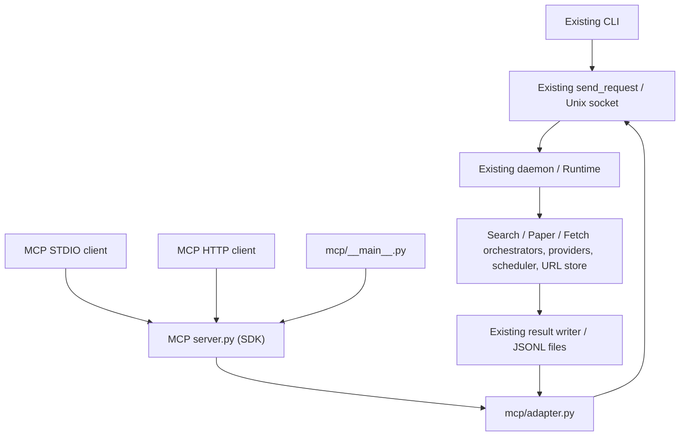

# Architecture: MCP Server (STDIO and Streamable HTTP)

Status: proposed for review
Baseline: v3.0.0, commit `dabfbbc`
Date: 2026-11-27

## 1. Scope & Assumptions

### In Scope

- Add the `agent-search-gateway-mcp` executable in the existing distribution, using the official Python MCP SDK with STDIO and Streamable HTTP transports.
- Expose exactly the five existing business operations as MCP tools. Both transports have identical tool definitions, input semantics, result text and error semantics.
- Reuse the local daemon and its existing typed request/response models and Unix-domain socket client. Return actual JSONL text for searches and final text for Fetch.
- Keep the existing CLI, daemon, Runtime, configuration, provider adapters, orchestrators, scheduler, credential pools, URL store and result writer unchanged.
- Document installation, launch, client configuration, security assumptions, result contracts and the shared-daemon dependency. Provide optional-dependency and transport test coverage.

### Todo / Out of Scope

- No new upstream MCP provider/client feature, legacy HTTP+SSE transport, resources, prompts, management tools, separate distribution, automatic daemon management, remote daemon protocol, internal authentication, OAuth server, TLS termination, user/tenant isolation, additional persistence, pagination, result summarization or new limits.
- No changes to daemon disconnect/cancellation semantics or existing request timeout policies.
- Dependency version selection and concrete SDK calls are implementation-plan tasks; verify the official SDK's supported Python versions, transport and security behavior before pinning or using them.

### Assumptions

- The existing daemon is the sole owner of the runtime. The MCP process runs on the daemon host under the same trusted OS account, using the existing `RuntimePaths.default()` paths. Remote MCP clients do not access that filesystem.
- The deployment is single-trust-domain, not a multi-tenant service. Operator-managed authentication and TLS (or a secure tunnel) protect remote access; all authorized callers share provider quotas, admitted URLs and body state.
- The project supports Python 3.11–3.14; the optional SDK and lock must remain compatible with the supported environment. The design introduces no new provider configuration.
- Existing search success produces an absolute JSONL path after the result writer completes; Fetch success produces final text. Neither result schema nor socket framing needs to change.

## 2. Architecture Summary

MCP is an independent, thin, stateless-with-respect-to-business-data frontend beside the CLI. The entry point selects STDIO or Streamable HTTP; one MCP server factory registers the same five tools on either transport. A small adapter maps validated arguments to existing Request objects, invokes `protocol.send_request(paths.socket_file, request)` once per call and translates Response objects: search success is a bounded-location file read, Fetch success is returned as-is. The daemon exclusively owns business execution, admission, rate/capacity gates, credential selection, retries and persisted result files. Dependencies point toward existing interfaces; no existing core component imports MCP.



## 3. Design Decisions

### Runtime Model

#### Separate command, same distribution

- Description: Register `agent-search-gateway-mcp = agent_search_gateway.mcp.__main__:main` in pyproject.toml. Place the MCP implementation in its own subpackage; use a `mcp` optional dependency extra and keep the existing CLI command and dependency path unchanged. Load the SDK only for MCP execution; when the extra is absent, the new command emits actionable installation guidance to stderr and exits unsuccessfully. Help and argument handling must not require the SDK.
- Rationale: One version/release and lock file; no changes to CLI parser or import graph; CLI-only installations do not acquire MCP dependencies. The SDK owns the protocol/transport machinery.
- Trade-offs: An optional entry point is installed even when the extra is absent; the missing-extra path must be explicit. Dependency resolution needs testing across supported Python versions.
- Rejected alternatives: A CLI subcommand adds an unnecessary dependency edge in cli.py; a second distribution adds release/version coordination; implementing MCP JSON-RPC manually adds protocol and compatibility burden.

#### Independent lifecycle and daemon client

- Description: MCP starts and allows initialization/tool discovery even if the daemon is unavailable. Neither transport starts, checks as a startup prerequisite, stops, restarts or owns the daemon. Every business call opens a fresh Unix socket through existing send_request; no persistent socket, background health poll or automatic retry.
- Rationale: Preserves existing CLI-style request semantics and allows daemon and MCP restart in either order.
- Trade-offs: Tool discovery does not certify business readiness; a call can fail if daemon is absent. A daemon restart clears its in-memory state as today.
- Rejected alternatives: Startup fail-fast still needs call-time handling and creates ordering dependence; auto-start/stop makes MCP responsible for a shared process; independent Runtime duplicates state and rate gates.

### Interface / Protocol

#### Two SDK transports, one tool surface

- Description: Support `--transport stdio|streamable-http` (proposed default stdio), HTTP `--host` (default 127.0.0.1), `--port` (default 8765), and fixed HTTP endpoint `/mcp`. HTTP-only options are rejected for STDIO rather than ignored. Use SDK transport/session management; no bespoke JSON-RPC implementation. Both transports use the same server factory and five tools in section 6. STDIO stdout is reserved for protocol frames. No legacy SSE endpoint; Streamable HTTP's own protocol-supported response forms are not disabled by that exclusion.
- Rationale: Supports the requested local and HTTP clients with no per-transport business implementation.
- Trade-offs: SDK client/session behavior and client transport support vary; there is no guarantee that clients can render unlimited result sizes.
- Rejected alternatives: Separate tool definitions per transport duplicate schemas; adding separate REST endpoints or exposing the internal socket protocol increases public surface.

#### Map existing request/response contracts

- Description: Use the existing business request dataclasses. Mirror CLI boundary normalization (strip nonempty query/prompt/selectors, exact scope and alias semantics, existing normalize_url helper, blank optional focus becomes None). Keep this small input mapping in the new module; do not import CLI internals or duplicate orchestrator logic. SDK validates tool argument types; the adapter handles semantic boundary validation. Map existing gateway errors to MCP tool errors, never successful text. Preserve useful error codes/messages subject to safe client-facing sanitization.
- Rationale: A typed, single request path avoids subprocess CLI parsing and avoids expanding the stable internal protocol. Only the minimal frontend input checks are repeated where necessary.
- Trade-offs: The existing request classes and socket protocol are private Python interfaces; the adapter must evolve alongside them in the same release.
- Rejected alternatives: Shelling out to CLI introduces process/argv/output coupling; calling orchestrators or daemon private methods bypasses the existing transport boundary; expanding the daemon protocol to inline all results changes a working CLI path.

### State Management

#### Shared daemon is the only business state owner

- Description: No new MCP store or per-session business cache. URL admission, fetch state, credential pool and request IDs remain daemon-owned; a URL admitted through CLI can be fetched through MCP and vice versa, subject to existing admission rules. Paper PDF metadata is not automatically admitted.
- Rationale: Prevents duplicated rate policy and inconsistent URL state across transports and multiple MCP processes.
- Trade-offs: No tenant/session isolation; a restart invalidates admitted in-memory URLs as before. MCP protocol session state belongs to the SDK, not the adapter.
- Rejected alternatives: Per-MCP runtime, per-client stores or daemon-independent caches duplicate or fragment state.

### Storage / Persistence

#### Return actual result text without changing storage

- Description: For successful search requests only, treat daemon Response.text as a server-generated absolute result-file path, never a user-supplied path. Validate it against RuntimePaths.results_dir; accept only regular JSONL result files within that directory (expected result naming/type, no traversal, external symlink or nonregular file). Resolve/check containment and safely open the file; do not rely on a string prefix check. Read UTF-8 text without parsing, rewriting, reordering, summarizing or truncating rows; preserve original line endings/content, including a successful empty file. Use asynchronous/offloaded file I/O so ordinary local reads do not block the MCP event loop. Return text only, not the path. Keep file ownership and retention unchanged; never delete or modify result files. Fetch response text is never interpreted as a path.
- Rationale: Remote clients can use results without access to local files; existing ResultWriter and JSONL schemas stay authoritative.
- Trade-offs: Reading the file into a text response adds memory/transfer proportional to result size; client or transport limits may still apply. A missing/unreadable/invalid file produces a tool error, not a second paid search. The safety check protects against unintended paths, not against a malicious process with the same OS account.
- Rejected alternatives: Returning paths breaks remote clients; returning path plus content leaks local layout unnecessarily; parsing into a second result model or changing the socket to inline data increases coupling.

### Provider Integration

#### No MCP-specific provider behavior

- Description: Provider selection uses the same optional exact, case-sensitive alias semantics as CLI. LLM/Agent scopes and model filters use existing rules; Fetch has no provider/model selector. Omitted filters retain daemon defaults. No credentials in MCP configuration, no provider discovery endpoints or direct provider calls. Existing search does not invoke Fetch body-processing stages; Fetch still requires admitted URL.
- Rationale: Maintains one source of truth for all provider behavior.
- Trade-offs: MCP cannot expose a provider capability absent from the existing daemon API.
- Rejected alternatives: Separate MCP registry, configuration and provider selection would duplicate the gateway core.

### Concurrency / Scheduling

#### Existing policy only

- Description: Each tool call awaits its own socket request asynchronously. Allow concurrent calls across STDIO/HTTP sessions and CLI; no adapter global semaphore, rate limit, queue, retry or default business timeout. Existing per-credential limits, retries, fetch ordering and per-URL locks remain authoritative. If SDK/client cancels a call, allow existing send_request cleanup to close the socket; do not claim this cancels daemon execution and do not issue shutdown. A later call is independent.
- Rationale: Preserves shared quota and avoids imposing a new capacity policy at an interface layer.
- Trade-offs: Client deadlines can end the wait earlier than daemon work; a disconnected client may leave daemon work running and a result file behind. No automatic retry avoids unintentional duplicate billable work.
- Rejected alternatives: New global cap or transport-level business scheduler contradicts existing optional credential gates; changing daemon cancellation is outside scope.

### Security

#### Loopback by default; external security for remote access

- Description: HTTP listens on 127.0.0.1 unless explicitly configured otherwise. Preserve SDK Host/Origin validation and DNS-rebinding protections; do not disable them to make remote deployments work. Document how a trusted reverse proxy can forward the endpoint with a narrowly allowed host/origin configuration where necessary, and how to use a secure tunnel. Non-loopback binding is explicit and warned about on stderr; an unauthenticated backend must never be directly internet-accessible. TLS, authentication and access restrictions belong to external infrastructure. No public shutdown/config/credential/file-read tool.
- Rationale: Caller access implies access to the operator's paid upstream quotas and shared daemon state. Local default and external protection avoid a second identity/auth subsystem.
- Trade-offs: No per-user quota/access separation and no native OAuth discovery; clients requiring such flows need compatible external infrastructure. Local processes with network access to the listener are part of the trust boundary.
- Rejected alternatives: Default 0.0.0.0 is unsafe; implementing token/OAuth/TLS/tenant state in gateway is outside current scope.

#### Minimize data disclosure

- Description: No result paths, credential values, raw exception tracebacks or config contents in tool responses. Use only the validated result-file location returned by the daemon, never a path parameter exposed to MCP. Restrict diagnostic messages to safe operator guidance and existing safe error metadata; avoid adding prompt/body logging at the MCP layer.
- Rationale: Limits the new boundary to the five intended business operations and result data.
- Trade-offs: Debugging requires existing daemon logs for detailed internals.

### Observability

#### Retain daemon diagnostics; minimal MCP diagnostics

- Description: Daemon continues assigning request IDs and logging provider/workflow events. MCP SDK logging and startup/transport diagnostics go to stderr, not STDIO stdout; no second business log file or duplicate body previews.
- Rationale: Keeps logging ownership with the executing workflow; protects MCP framing.
- Trade-offs: MCP errors do not include local result paths or a new correlation system. Existing daemon diagnostics remain the operator's source of detail.

### Future Migration / Compatibility

- Description: The new command, documented options, five tool names/arguments, result text and error semantics become documented user-facing interfaces. Existing CLI/config/JSONL contracts remain unchanged. The socket protocol and Python imports remain internal. Document the added feature and use a backward-compatible minor release under existing compatibility policy, without changing the version during spec writing. Update lock and CI to exercise the extra while preserving CLI-only installation.
- Rationale: Adds functionality without a new API version or breaking change.
- Trade-offs: Future changes to MCP's documented public surface require the normal compatibility process; actual SDK release/compatibility evidence belongs in the implementation plan.
- Rejected alternatives: Separate release/version stream, changing CLI stdout or a new stable Python SDK are unnecessary.

## 4. Component Catalog

| Component | Purpose | Key Responsibilities | Public Interfaces | Dependencies | Owns State? | Data-Flow Role |
|---|---|---|---|---|---|---|
| mcp/__init__.py | Package marker | No runtime side effects | None | None | No | Package boundary |
| mcp/__main__.py | Executable entry | Parse options, lazy load SDK-backed server, start transport, exit on startup errors | agent-search-gateway-mcp command | stdlib, server factory | Transport options only | Source/coordinator |
| mcp/server.py | MCP protocol adapter | Construct one SDK server, register five typed/described tools, return SDK text/error results | tools/list, tools/call via SDK | Official MCP SDK, adapter | SDK session/transport state only | Protocol boundary |
| mcp/adapter.py | Daemon client adapter | Normalize inputs, construct existing Requests, call send_request, translate errors, safely read search JSONL | Internal async functions or a small adapter with injectable paths/client | models.py, protocol.py, paths.py, errors.py, url_normalization.py, stdlib | No business state | Transformer/validator |
| Existing protocol.py | Local RPC | Encode/decode requests and responses; socket connection cleanup | Existing send_request | Existing models/errors | Connection per request | Transport |
| Existing ForegroundDaemon and Runtime | Execute workflows | Dispatch, lifecycle, IDs, provider selection and all business logic | Existing internal socket protocol | Existing core | Yes | Coordinator |
| Existing ResultWriter and results directory | Persist results | Existing search serialization and file creation | Existing search success path | Existing models/paths | Yes, existing files | Sink/source for adapter |
| Existing CLI | Existing client | Existing arguments, socket calls, stdout | Unchanged CLI | Existing protocol | No | Source |

The adapter must not depend on the MCP SDK or CLI module; it can be tested with a fake typed socket client. The server owns MCP-specific result/error representation. No new generic service abstraction or dependency-injection framework is necessary.

Expected implementation files:

- New: src/agent_search_gateway/mcp/{__init__.py,__main__.py,server.py,adapter.py}.
- Modify: pyproject.toml (entry point and optional extra), uv.lock, README.md, docs/public-interface.md, CHANGELOG.md; CI only if needed for optional-dependency coverage.
- New: tests/mcp/ tests for adapter, server, entry point, STDIO and Streamable HTTP.
- No changes to existing core Python modules or config.example.toml. If implementation reveals a genuine blocker to this boundary, raise it for design review rather than silently refactoring core.

## 5. Data Flow

Pseudocode expresses contracts, not a prescribed SDK API or concrete implementation.

### 5.1 Entry point: STDIO

```text
entry.main(argv):
    options = parse_cli_options(argv)
    if options invalid: write usage to stderr; exit nonzero
    if help requested: show help; exit success
    if MCP extra unavailable: write installation guidance to stderr; exit nonzero
    paths = RuntimePaths.default()
    server = server.create(adapter(paths, send_request))
    try:
        SDK.run_stdio(server)  # stdout only protocol frames
    catch startup/transport failure:
        log safe diagnostic to stderr; exit nonzero
    finally:
        SDK closes its own resources, not the daemon
```

### 5.2 Entry point: Streamable HTTP

```text
entry.main(argv):
    options = parse_cli_options(argv)
    if options invalid: write usage to stderr; exit nonzero
    if help requested: show help; exit success
    if MCP extra unavailable: write installation guidance to stderr; exit nonzero
    paths = RuntimePaths.default()
    server = server.create(adapter(paths, send_request))
    if explicit non-loopback host: warn on stderr
    try:
        SDK.run_streamable_http(server, host, port, "/mcp", security protections)
    catch bind/startup/transport failure:
        log safe diagnostic to stderr; exit nonzero
    finally:
        SDK closes its own resources, not the daemon
```

Neither startup path contacts the daemon as a prerequisite. SDK handles initialization and tool discovery independently of daemon readiness.

### 5.3 Entry point: keyword_search

```text
server.keyword_search(query, provider=None):
    try:
        request = adapter.keyword_request(query, provider)
        text = await adapter.execute(request, expected_result_kind="keyword")
        return SDK.success_text(text)
    catch input/adapter/Gateway error:
        return SDK.tool_error(safe_code_and_message)
    # cancellation propagates without retry or shutdown
```

### 5.4 Entry point: paper_search

```text
server.paper_search(query, provider=None):
    try:
        request = adapter.paper_request(query, provider)
        text = await adapter.execute(request, expected_result_kind="paper")
        return SDK.success_text(text)
    catch input/adapter/Gateway error:
        return SDK.tool_error(safe_code_and_message)
```

### 5.5 Entry point: llm_search

```text
server.llm_search(prompt, scope="web", provider=None, model=None):
    try:
        request = adapter.llm_request(prompt, scope, provider, model)
        text = await adapter.execute(request, expected_result_kind="llm")
        return SDK.success_text(text)
    catch input/adapter/Gateway error:
        return SDK.tool_error(safe_code_and_message)
```

### 5.6 Entry point: agent_search

```text
server.agent_search(prompt, scope="web", provider=None, model=None):
    try:
        request = adapter.agent_request(prompt, scope, provider, model)
        text = await adapter.execute(request, expected_result_kind="agent")
        return SDK.success_text(text)
    catch input/adapter/Gateway error:
        return SDK.tool_error(safe_code_and_message)
```

### 5.7 Entry point: url_fetch

```text
server.url_fetch(url, focus=None):
    try:
        request = adapter.fetch_request(url, focus)
        text = await adapter.execute(request, expected_result_kind=None)
        return SDK.success_text(text)
    catch input/adapter/Gateway error:
        return SDK.tool_error(safe_code_and_message)
```

### 5.8 Common adapter flow (all five tools)

```text
adapter.execute(request, expected_result_kind):
    # request already mapped/validated; kind inferred by tool, never client-supplied
    try:
        response = await send_request(paths.socket_file, request)
    catch DaemonUnavailable:
        raise adapter_error("daemon not running; run agent-search-gateway start")
    catch protocol/connection/explicit timeout error:
        raise adapter_error(safe failure; no retry)
    catch cancellation:
        propagate  # existing socket client closes its connection

    if response is ErrorResponse:
        raise adapter_error(response.error, sanitized response.message)
    if response is not SuccessResponse:
        raise adapter_error("invalid daemon response")

    if expected_result_kind is None:
        return response.text  # Fetch, never read a file

    try:
        file = validate_daemon_result_path(response.text, paths.results_dir, expected_result_kind)
        return await read_regular_utf8_file_without_content_transformation(file)
    catch invalid path/missing file/read/decode failure:
        raise adapter_error("search result unavailable or invalid")
    catch cancellation:
        propagate
```

Daemon handles search success, empty success, partial success, no-provider failure, URL admission and Fetch stages exactly as before. The adapter never sends a second request to recover a result-read failure.

## 6. Interfaces & Contracts

### Public command

```bash
agent-search-gateway start
agent-search-gateway-mcp --transport stdio
agent-search-gateway-mcp --transport streamable-http --host 127.0.0.1 --port 8765
```

Install using the distribution's `mcp` extra (for example, `pip install 'agent-search-gateway[mcp]'` after release). Do not require the extra for the existing CLI. HTTP endpoint: `http://127.0.0.1:8765/mcp`.

### Public tool contracts

| Tool | Required fields | Optional fields/defaults | Existing request | Success result |
|---|---|---|---|---|
| keyword_search | query: str | provider: str or null = null | KeywordSearchRequest | Existing keyword JSONL text |
| paper_search | query: str | provider: str or null = null | PaperSearchRequest | Existing paper JSONL text |
| llm_search | prompt: str | scope: web/paper/all = web; provider/model: str or null = null | LLMSearchRequest | Existing LLM JSONL text |
| agent_search | prompt: str | scope: web/paper/all = web; provider/model: str or null = null | AgentSearchRequest | Existing Agent JSONL text |
| url_fetch | url: str | focus: str or null = null | URLFetchRequest | Existing final Fetch text |

Required text must not be blank after CLI-equivalent normalization. Optional selectors are exact and case-sensitive after trimming and cannot be blank when provided; omitted selectors preserve daemon defaults. The adapter uses the existing URL normalization helper and does not admit arbitrary URLs. Describe scope, filters, result format and URL admission in tool metadata. No extra result count, filepath, timeout, provider selection for Fetch, or management arguments.

Example MCP tool call arguments:

```json
{"query":"distributed systems","provider":null}
```

Example search success text (JSONL, unchanged from the existing file):

```jsonl
{"url":"https://example.org/article","abstract":"Example search summary"}
```

The actual MCP response contains text content with that JSONL, not a new structured result schema or local filepath. Paper and mixed rows retain their existing schema and ordering. Empty successful search is an empty successful text result, not a failure. Fetch returns daemon final text unchanged. Execution errors use the SDK's tool-error mechanism (`isError: true`), not successful text, with an actionable sanitized message and existing gateway error code when applicable. SDK protocol-level validation/initialization failures follow SDK semantics.

### Internal contracts

- `Request` and `Response` from models.py; `send_request(socket_path, request)` from protocol.py; `RuntimePaths` from paths.py; existing errors and URL normalization. No changes to wire schema or frame limits. No stable Python SDK promise.
- Search success path is internal and only accepted for search result reading after directory/type validation. Fetch success text is never opened. Do not propagate server filesystem paths to clients.
- Use official SDK implementation for protocol, transport and session lifecycle; select a tested compatible version at implementation time.

### Acceptance boundary

- Both transports list the same five tools and produce equivalent results for equivalent requests using a controlled daemon.
- CLI-only install and all existing CLI/daemon contracts remain operational; no new core Python module modifications.
- CLI and MCP share the daemon's existing admission and scheduling state; no MCP-specific runtime or additional provider calls.
- MCP can start before daemon, reports a tool error while it is down and succeeds on a later request after it becomes available without restarting MCP.
- Actual search output is preserved, with no exposed file path, and no additional upstream calls on file failures or cancellation.
- Error Handling and Testing companion specs will detail failures and verification after architecture approval.
